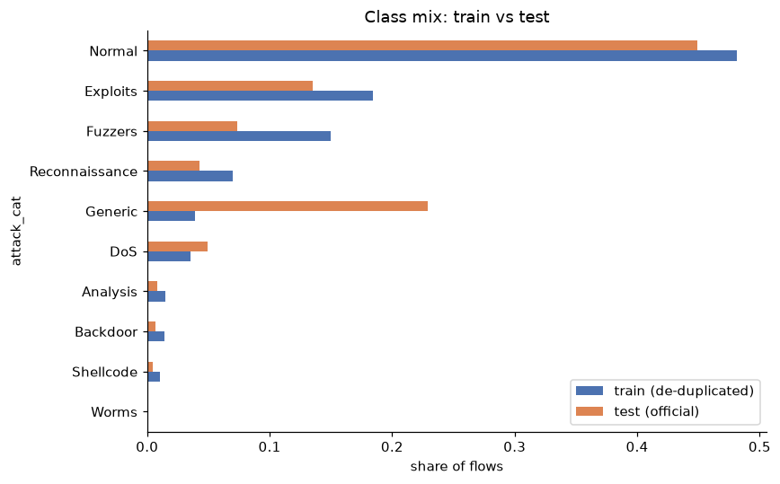
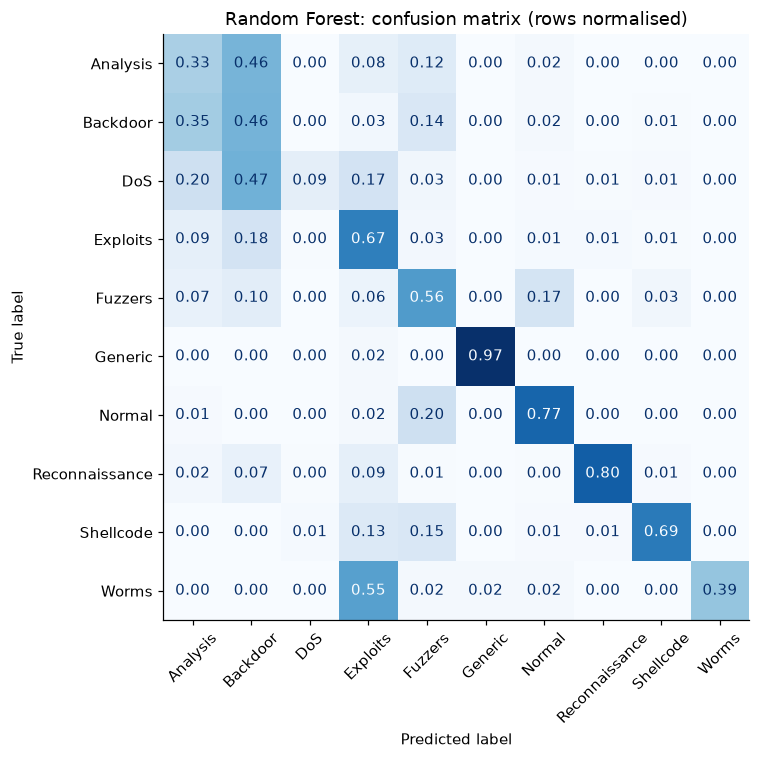
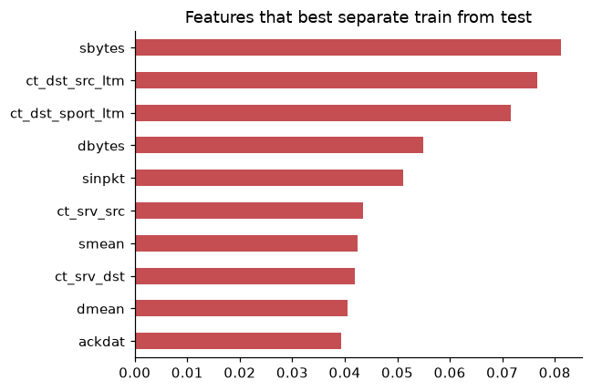
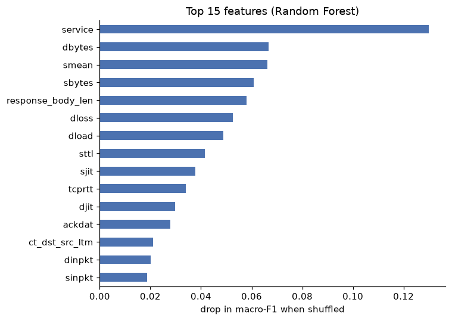

# Network Intrusion Detection on UNSW-NB15

Classifying network flows as normal or one of nine attack types (Generic, Exploits, Fuzzers, DoS, Reconnaissance, Analysis, Backdoor, Shellcode, Worms) with scikit-learn, **trained on the official UNSW-NB15 training file and evaluated on the official testing file**.

Notebook: [`Network_Packets_Classifier.ipynb`](Network_Packets_Classifier.ipynb)

## Summary

- **The detector catches almost every attack but over-alerts.** Binary recall is about 0.98 to 0.99 for the tree models, but roughly **25% of normal test flows are flagged as attacks** (false-alarm rate 0.25 for gradient boosting, 0.27 for random forest). Best binary F1 is 0.90.
- **Attack-type identification is hard.** The best multiclass model (random forest) reaches 0.75 accuracy and **0.51 macro-F1**. Generic, Reconnaissance and Normal are handled well; DoS, Analysis and Backdoor are not.
- **The train and test files differ, and that costs performance.** A classifier can tell training flows from test flows with AUC 0.855, and normal-traffic recall drops from 0.92 (in-distribution holdout) to 0.77 (official test). Shift is not the whole story, though: the rare classes are also hard in-distribution.
- **Random forest is more robust than gradient boosting for multiclass.** Gradient boosting is marginally better at the binary task, but random forest wins on multiclass macro-F1 and accuracy.

## Approach

- Train on the official training file; test on the official testing file, which is never used for fitting or preprocessing
- Remove duplicate flows from the training data (38.6% of rows) so repeated flows are not over-weighted; the test set is kept as shipped, with scores on a de-duplicated copy as a sensitivity check
- All preprocessing fitted inside scikit-learn `Pipeline`s on the training data only
- Two tasks: binary (`label`) and multiclass (`attack_cat`)
- Majority-class baseline, logistic regression, random forest and histogram gradient boosting, with class weighting
- Reports macro-F1, false-alarm rate, per-class metrics, a confusion matrix, permutation importance, and two diagnostics for the train/test gap (holdout comparison and adversarial validation)

## Data

| | Rows | Exact duplicates | Rows used |
|---|---|---|---|
| Training file | 175,341 | 67,601 (38.6%) | 107,740 (de-duplicated) |
| Testing file | 82,332 | 26,387 (32.0%) | 82,332 (as shipped); 55,945 de-duplicated copy for checks |

The class mix differs between the files, most visibly Generic (3.9% of the de-duplicated training data, 22.9% of the test set):

| Class | Train (de-dup) | Test |
|---|---|---|
| Normal | 48.2% | 44.9% |
| Exploits | 18.4% | 13.5% |
| Fuzzers | 15.0% | 7.4% |
| Reconnaissance | 7.0% | 4.2% |
| Generic | 3.9% | 22.9% |
| DoS | 3.5% | 5.0% |
| Analysis | 1.5% | 0.8% |
| Backdoor | 1.4% | 0.7% |
| Shellcode | 1.0% | 0.5% |
| Worms | 0.1% | 0.1% |

## Results

All numbers are on the **official test set**.

### Binary: normal vs attack

| Model | Accuracy | Precision | Recall | F1 | ROC-AUC | False-alarm rate |
|---|---|---|---|---|---|---|
| Dummy (majority) | 0.551 | 0.551 | 1.000 | 0.710 | 0.500 | 1.000 |
| Logistic Regression | 0.818 | 0.762 | 0.975 | 0.855 | 0.958 | 0.374 |
| Random Forest | 0.872 | 0.819 | 0.985 | 0.894 | 0.980 | 0.267 |
| Gradient Boosting | **0.879** | **0.827** | **0.987** | **0.900** | **0.987** | **0.252** |

*False-alarm rate = share of normal flows wrongly flagged as attacks. The dummy predicts "attack" for everything (attacks are the majority after de-duplication), so its F1 of 0.71 is not a meaningful score.*

On the de-duplicated test set, precision drops further (gradient boosting 0.718, F1 0.827) because attacks are a smaller share of the data, but the **false-alarm rate barely moves (0.243)**. That rate does not depend on how common attacks are, so the over-alerting is a stable property of the model on this data.

Gradient boosting's ROC-AUC of 0.987 is much higher than its F1 suggests. This means the model ranks flows well, and a large part of the false-alarm problem may be down to the default 0.5 threshold, which was effectively calibrated on the training distribution. Tuning the threshold on representative validation data is the obvious next step.

### Multiclass: attack type

| Model | Accuracy | Macro-F1 | Weighted-F1 |
|---|---|---|---|
| Dummy (majority) | 0.449 | 0.062 | 0.279 |
| Logistic Regression | 0.614 | 0.347 | 0.680 |
| Random Forest | **0.748** | **0.513** | **0.782** |
| Gradient Boosting | 0.665 | 0.485 | 0.722 |

On the de-duplicated test set the ranking is unchanged: random forest 0.755 accuracy / 0.544 macro-F1, gradient boosting 0.642 / 0.512.

### Per-class performance (random forest)

| Class | Precision | Recall | F1 | Test support |
|---|---|---|---|---|
| Generic | 1.00 | 0.97 | 0.98 | 18,871 |
| Reconnaissance | 0.94 | 0.80 | 0.86 | 3,496 |
| Normal | 0.96 | 0.77 | 0.85 | 37,000 |
| Exploits | 0.74 | 0.67 | 0.71 | 11,132 |
| Worms | 0.68 | 0.39 | 0.49 | 44 |
| Shellcode | 0.35 | 0.69 | 0.47 | 378 |
| Fuzzers | 0.30 | 0.56 | 0.39 | 6,062 |
| DoS | 0.73 | 0.09 | 0.16 | 4,089 |
| Analysis | 0.07 | 0.33 | 0.12 | 677 |
| Backdoor | 0.05 | 0.46 | 0.09 | 583 |

### What the errors tell us

- **Normal traffic is being read as Fuzzers.** 20% of Normal flows are predicted as Fuzzers, which is most of the 23% of Normal flows that get flagged at all. In the other direction, 17% of Fuzzers flows are predicted as Normal. The two classes overlap heavily, which both drives the false alarms and drags Fuzzers precision down to 0.30.
- **DoS is almost never recognised (recall 0.09).** 47% of DoS flows are predicted as Backdoor, 20% as Analysis and 17% as Exploits. Its precision is high (0.73), so the model is conservative about calling DoS, and DoS traffic in the test file does not look like DoS in the training file.
- **Analysis and Backdoor are confused with each other** (46% of Analysis predicted as Backdoor, 35% of Backdoor as Analysis) and also bleed into Fuzzers and Exploits. Their precision is under 0.10 because so many flows from large classes are misassigned to them.
- **Worms (44 test flows) and Shellcode (378) are small,** so their scores are noisy. 55% of Worms flows are predicted as Exploits.
- **Generic is nearly perfect (F1 0.98)**, which helps overall accuracy because Generic is 23% of the test set.

## Why the scores are lower than in-distribution

### Holdout vs official test

The selected model (random forest) was also trained on 80% of the training file and scored on the other 20%:

| | Accuracy | Macro-F1 | Attack-vs-normal F1 | Normal recall |
|---|---|---|---|---|
| In-distribution holdout (20% of train) | 0.815 | 0.570 | 0.936 | 0.923 |
| Official test set | 0.748 | 0.513 | 0.900 | 0.770 |

The largest change is **normal recall, down 15 points**: benign test traffic is much more likely to be flagged. Accuracy falls 7 points and macro-F1 about 6.

Two things follow. First, the shift mainly shows up as extra false alarms. Second, **shift does not explain everything**: even in-distribution, multiclass macro-F1 is only 0.57, so the rare and overlapping classes are hard regardless.

### Adversarial validation

A random forest trained to tell training flows from test flows reaches **AUC 0.855** (0.5 would mean indistinguishable), so the two files differ systematically.

The most-shifted features are byte counts and packet sizes (`sbytes`, `dbytes`, `smean`, `dmean`), several connection-tracking counts (`ct_dst_src_ltm`, `ct_dst_sport_ltm`, `ct_srv_src`, `ct_srv_dst`), and inter-packet timing (`sinpkt`, `ackdat`).

## Which features matter

The model leans most on `service`, then `dbytes`, `smean` and `sbytes`, followed by `response_body_len`, `dloss`, `dload` and `sttl`.

The byte-size features (`sbytes`, `dbytes`, `smean`) appear in **both** lists: the model relies heavily on them and they are among the features that differ most between the files. That makes them the most likely contributors to the train/test gap. This is an association, not proof; an ablation retraining without them (or without the `ct_*` counts) would test it.

Cautions: correlated features share importance under permutation, so individual bars understate related groups; and features such as `service` and `sttl` may encode how the simulated testbed was built rather than attack behaviour that generalises. (`sttl` ranked first in an earlier random-split experiment and is eighth here, but that used a different model and data, so it is only suggestive.)

## Limitations

- **Single run, no confidence intervals.** Small classes (Worms, Backdoor, Analysis) are noisy.
- **Model selection used the test set.** The "best" model is chosen by test macro-F1, so its score is slightly optimistic. A stricter protocol would select by cross-validation on the training data.
- **Unseen categories.** The test file contains `state` values (`ACC`, `CLO`) that never appear in training. The encoder is set to map unseen categories to its rare-category bucket (or to all zeros if no such bucket exists), so those flows are handled without error but not informatively.
- **No hyperparameter tuning.** Models use near-default settings.
- **Dataset artifacts.** The data is simulated; results may not transfer to real networks.
- **Flow-level features only.** No payload or temporal sequence information.

## Next steps

- Tune the decision threshold for a target false-alarm rate (ROC-AUC 0.987 suggests there is room)
- Ablations: retrain without the byte-size features, the `ct_*` counts, and `sttl`/`service`
- Cross-validated hyperparameter search and model selection on the training set
- Better handling of rare classes: resampling inside the CV loop, or a two-stage model (attack vs normal, then attack type)
- Quantify how many test flows have unseen `state` values and test their effect
